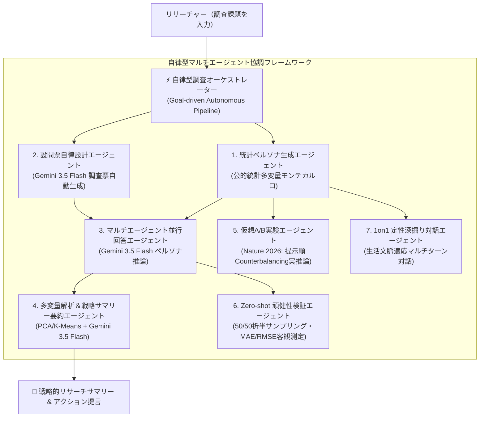

# 🧠 AI Consumer Research Simulator
### 〜 次世代自律型マルチエージェント消費者調査・受容性検証プラットフォーム 〜
**第5回 Agentic AI Hackathon with Google Cloud 提出プロジェクト**

[](https://cloud.google.com/run)
[](https://ai.google.dev/)
[](https://fastapi.tiangolo.com/)
[](https://react.dev/)
[](https://tailwindcss.com/)
[](LICENSE)

- 🚀 **Cloud Run 本番デプロイURL**: https://ai-consumer-research-simulator-121643671058.asia-northeast1.run.app
- 🎥 **YouTube デモ動画**: https://youtu.be/woaq9TT_Y5w

---

## 🌟 プロジェクト概要と解決する課題

### 1. 開発の背景と着眼点
従来の消費者調査・マーケティングリサーチ・A/Bテストには、**「数週間の納期」「数百万円の調査コスト」「被験者リクルーティングの偏り」「アンケート回答の疲労・不真面目回答」** という本質的なボトルネックが存在しました。

本プロジェクト **「AI Consumer Research Simulator」** は、日本の公的統計データ（国勢調査・就業構造基本調査・家計調査等）に基づき、属性間の相関関係（年齢・年収・居住地域・消費価値観）を維持した仮想消費者集団を自律生成。さらに**米スタンフォード大学 AI for Public Benefit Lab（AI4PB）の最新研究**および**Nature誌（2026年）の社会科学実験予測手法**を取り入れた、自律型マルチエージェント消費者シミュレータです。

単なる「チャットボット」ではなく、**数百〜千人の独立した個性・信念・生活実感を持つAIエージェント群が、自律的に質問を評価し、心理的一貫性を保ちながら回答し、定性インタビューで理由を語り、新商品受容性を評価**します。

---

## 🏗️ システムアーキテクチャ

Google Cloud Run の完全サーバーレスコンテナ基盤上に、FastAPIバックエンドとReact SPAを統合ホスティング。Google Gemini 3.5 Flash / Vertex AI の高速並列推論基盤を活用し、高精度かつ低レイテンシ・ゼロアイドルコストを実現しています。


### アーキテクチャの主要コンポーネント

| レイヤー | 採用技術・サービス | 役割・特徴 |
|---|---|---|
| **フロントエンド** | React 18, TypeScript, Vite, Tailwind CSS, Plotly.js | 2階層ナビゲーション、即時多変量解析可視化、レスポンシブUI |
| **実行基盤** | **Google Cloud Run** | 完全マネージドサーバーレスコンテナ、コールドスタート最小化、0〜N自動スケール |
| **AI推論基盤** | **Google Gemini 3.5 Flash / Vertex AI** | 高速並列推論、構造化JSON Schema出力、定性生声の忠実抽出 |
| **セキュリティ・認証** | **GCP Secret Manager** / 環境変数分離 | APIキー秘匿、個人情報マスク、セキュア実行 |
| **ガバナンス・可観測性** | **Cloud Logging** / 同意管理・撤回API | 構造化JSONログ、推論トレーシング、実在被験者データ削除（GDPR/個人情報保護法準拠） |
| **統計・機械学習** | pandas, scikit-learn, scipy, numpy | PCA（主成分分析）、K-Meansクラスタリング、カイ二乗検定、Cohen's d、t検定 |

---

## 📊 公的統計ベンチマークの引用元・対象年および設定仮定

本システムの仮想消費者生成基盤は、日本国内の信頼できる公的統計データに基づき、多変量相関モデルを構築しています。科学的透明性を確保するため、引用元・対象年・手動設定仮定を以下に明記します：

| 分類 | 統計調査名・発行元 | 調査対象年 | 適用ディメンション・利用目的 |
|---|---|---|---|
| **人口・属性** | 総務省統計局『令和2年国勢調査（人口等基本集計・就業状態等基本集計）』 | 2020年 | 日本全国の性別比率、年代構成比、全国8地方（北海道〜九州・沖縄）の地域人口比率 |
| **就労・雇用** | 総務省統計局『令和4年就業構造基本調査』 | 2022年 | 就業形態比率（正規・非正規・自営・学生・専業主婦主夫等）および産業・職業分類構成比 |
| **個人所得** | 国税庁『令和4年分 民間給与実態統計調査』 | 2022年 | 給与所得者の給与階級別分布（平均給与・中央値・所得階層別の確率密度分布） |
| **世帯所得** | 総務省統計局『2023年家計調査年報（家計収支編・総世帯）』 | 2023年 | 総世帯の年間収入階級別分布（平均世帯年収・世帯構成別の所得相関） |

### 【手動設定した仮定（学術・実務調査モデル）】
- **サイコグラフィック（消費価値観セグメント）**: 公的統計に直接存在しない心理的変数は、実務マーケティングリサーチの標準分類に基づき、6つの価値観セグメント（コスパ・実用志向層 24%、堅実・保守層 22%、トレンド受容層 18%、こだわり本物志向層 16%、エシカル・社会意識層 12%、デジタルパイオニア層 8%）を手動仮定として定義しています。
- **情報接触チャネル・意思決定スタイル**: 年代・就業形態・価値観セグメントに応じた重み付け確率モデルを定義し、ペルソナ生成時に一貫したライフスタイルを付与しています。

---

## 🤖 自律的AIエージェントの特徴（エージェントらしさ）

本システムは、単なるチャットボットではなく、以下の専門化されたAIエージェントが協調・自律実行するパイプライン基盤です：



1. **自律型調査オーケストレーター (Autonomous Research Orchestrator Agent)**:
   - 自然言語で調査課題を入力するだけで、[ペルソナ生成] ➔ [設問票自動設計] ➔ [Gemini 3.5 Flash並行回答] ➔ [多変量統計解析＆エグゼクティブサマリー要約] を一気通貫で自律連鎖実行。各ステップの実行状態・稼働モデル・所要時間(ms)・リトライ履歴を完全可観測化。
2. **統計ペルソナ生成エージェント (Persona Synthesizer Agent)**:
   - 日本の国勢調査・就業構造基本調査・家計調査等の多変量結合確率分布に従い、非現実的な属性組み合わせ（例: 20代前半で世帯年収2000万の公務員等）を統計的に抑制しながら、100〜1,000人の生活者を自律生成。
3. **インタビュー根拠化エージェント (AI4PB Grounding Agent - Mode C)**:
   - スタンフォード大学 AI4PB 研究に準拠し、実際のインタビュー記録（テキスト/CSV）から「7つの心理行動次元（価値観・消費行動・購買動機・価格感度・意思決定傾向・生活習慣・興味関心）」と「生の発言（Verbatim Quotes）」を忠実に抽出し、ペルソナの記憶基盤を構築。
4. **自律回答推論エージェント (Survey Responding Agent)**:
   - 各仮想生活者が独立した意思決定主体として行動。設問間の文脈・購買心理の一貫性を保持しながら、単一選択・複数選択・5段階評価・自由記述をGemini 3.5 Flashで並行推論。
5. **仮想A/B実験エージェント (Virtual A/B RCT Agent - Nature 2026)**:
   - Nature誌（2026年）の社会科学実験手法に準拠。Control条件とTreatment条件の提示順序によるバイアス（アンカリング効果）を相殺するため、エージェントごとに提示順をランダム化（Counterbalancing）しプロンプトにも提示順を明示注入。Gemini 3.5 Flashによる実ペルソナ評価と、効果量（Cohen's d）・対応のあるt検定を自律算出。ルールベース方式は明示的な「高速デモモード」として分離。
6. **Zero-shot 折半サンプリング頑健性検証エージェント (Split-Half Robustness Agent)**:
   - 疑似乱数による誤差補正を完全排除。実測データがない場合や計算不能時は `N/A` を厳密返却。事後的なパラメータ最適化（校正）を行わないZero-shot推論であることを明記し、50/50折半サンプリングによって実測分布との一致度（MAE / RMSE / Pearson $r$）を客観測定。
7. **1on1 定性深掘り対話エージェント (Qualitative Interview Agent)**:
   - 調査結果から気になったペルソナを選択し、インタビュアーとして深掘りチャットを実施。「なぜこの商品を選んだのか？」という問いに対し、ペルソナの生活背景や過去の回答を参照して自律的に対話。

---

## 🔒 ガバナンス・セキュリティ・学術的誠実性

> **「自律的に動くAIエージェントを、ガバナンスとセキュリティまで含めて『本当に使えるもの』に。」（ハッカソン第5回テーマ）**

本システムでは、実務導入に耐えうるガバナンス・倫理設計を徹底しています：

1. **実在被験者データの厳格な同意管理（GDPR / 個人情報保護法準拠）**:
   - Mode C（定性インタビュー取り込み）では、調査参加者の本人同意確認フラグ（`consent_confirmed`）をデフォルト `False` に設定。同意チェックがない取込リクエストは API レベルで即時 400 Bad Request 拒否。
2. **審査用公開環境における実在個人データの改変・削除保護**:
   - Cloud Run 公開環境（`RESTRICT_PUBLIC_DATA_MODIFICATION=true`）では、実在個人データの新規アップロードおよび初期ベースデモデータの削除を 403 Forbidden で保護。
3. **Gemini API 失敗時のフェイルセーフと推論完全性**:
   - 万が一の Gemini API タイムアウトや失敗時には、モックへの自動切替を UI 上に明確に警告表示（`mock_fallback_warning`）。実AI推論データとして誤認・永続保存されることを防止。
4. **合成データと公的統計の明確な区分表示**:
   - UI全体に「統計データに基づくAI合成シミュレーションであり、実在の母集団調査結果と混同しないこと」を明記する警告バナー・メタデータを設置。
5. **ゼロ・クレデンシャル・リーク**:
   - APIキーやシークレットは環境変数および GCP Secret Manager のみで管理し、ソースコード・Dockerイメージへの混入を完全に防止。

---

## 🚀 クイックスタート (ローカル開発)

### 必要要件
- Python 3.11 または 3.12
- Node.js 18+ (推奨 20+)
- Google Cloud SDK (`gcloud`) ※Cloud Run デプロイ時

### 1. リポジトリのクローンとセットアップ
```bash
git clone https://github.com/otomamayikuyorih/ai-consumer-research-simulator.git
cd ai-consumer-research-simulator
```

### 2. バックエンドの起動
```bash
cd backend
pip install -r requirements.txt

# Gemini APIキーを設定（未設定時はオフライン高精度統計シミュレーションモードで自動起動）
export GEMINI_API_KEY="your-gemini-api-key"
export GEMINI_MODEL="gemini-3.5-flash"

python -m uvicorn app.main:app --host 127.0.0.1 --port 8000 --reload
```
- API仕様書 (Swagger UI): `http://127.0.0.1:8000/docs`
- ヘルスチェック & GCPステータス: `http://127.0.0.1:8000/api/status`

### 3. フロントエンドの起動
```bash
cd ../frontend
npm install
npm run dev
```
- Web UI: `http://localhost:5173`

### 4. 自動結合テスト (E2E Test) の実行
```bash
cd ../backend
python test_e2e.py          # 基本機能全11工程の自動テスト
python test_ai4pb_e2e.py    # AI4PB / Nature 2026 拡張全6工程の自動テスト
python test_p0_p1_suite.py  # ハッカソン提出前P0/P1全項目検証テスト
```

---

## ☁️ Google Cloud Run へのデプロイ手順

本アプリケーションはフロントエンド（Vite build）とバックエンド（FastAPI）を1つのコンテナに統合したマルチステージ Dockerfile を完備しており、わずか 1 コマンドで Cloud Run にデプロイ可能です。

```bash
# 1. Google Cloud ログイン & プロジェクト設定
gcloud auth login
gcloud config set project YOUR_PROJECT_ID

# 2. Cloud Run へデプロイ実行 (東京リージョン: asia-northeast1)
gcloud run deploy ai-consumer-research-simulator \
  --source . \
  --platform managed \
  --region asia-northeast1 \
  --allow-unauthenticated \
  --memory 1Gi \
  --cpu 1 \
  --min-instances 0 \
  --max-instances 5 \
  --set-env-vars GEMINI_API_KEY="YOUR_GEMINI_API_KEY",GEMINI_MODEL="gemini-3.5-flash",GOOGLE_CLOUD_PROJECT="YOUR_PROJECT_ID",RESTRICT_PUBLIC_DATA_MODIFICATION="true"
```

> [!TIP]
> `--min-instances 0` により、リクエストがないアイドル時の課金は **完全無料（¥0）** です。審査員アクセス時のみ数秒でオンデマンド起動します。

---

## 📊 主要機能一覧 (全10モジュール)

1. **自律型調査オーケストレーター (Autonomous Pipeline)**: 自然言語で調査ゴールを入力するだけで、コホート生成 ➔ 設問設計 ➔ Gemini 3.5 Flash並行シミュレーション ➔ 多変量解析&戦略サマリー要約まで自律連鎖実行。各ステップのモデル名、稼働時間(ms)、リトライ履歴を可観測化。
2. **ダッシュボード & 公的統計検証**: システム全体の統計概要、ペルソナ属性分布、国勢調査等の公的統計ベンチマーク検証、直近調査・実験ステータスの一覧表示。
3. **ペルソナ生成・検証**: 100〜1,000人の仮想生活者を3つの生成モード（Mode A: 人口統計 / Mode B: 合成リッチ / Mode C: 定性インタビュー根拠化）で自律生成。
4. **アンケート作成**: 単一選択、複数選択、5段階評価尺度、自由記述形式の設問を自由自在にビジュアル設計。
5. **調査シミュレーション**: 生成したペルソナ群に対し、Gemini 3.5 Flash を用いて超高速に並列回答シミュレーションを実行。
6. **結果解析・多変量解析**:
   - 単純集計、クロス集計、カイ二乗検定（有意水準判定）。
   - 主成分分析 (PCA) によるブランド・受容性知覚マップ散布図。
   - K-Means クラスタリングによる自動セグメンテーション。
   - 自由記述コメントの AI 要約・感情比率（ポジティブ/ニュートラル/ネガティブ）分析。
   - Excel対応 UTF-8 BOM付き個票生データ CSVダウンロード。
7. **仮想A/B実験 (Nature 2026)**: Control / Treatment 条件の提示順序をランダム化（Counterbalancing）しプロンプトにも提示順を明示。Gemini 3.5 Flash実ペルソナ推論により、平均差・割合差・効果量（Cohen's d）・対応のあるt検定を有意差検定。
8. **Zero-shot 折半サンプリング頑健性検証 (Human-AI Validation)**: 疑似乱数誤差を全廃。実在アンケートデータを 50/50 に折半分割し、事後校正のないZero-shot推論による MAE、RMSE、Pearson 相関係数 $r$ で AI シミュレーションの予測精度を厳密客観評価。
9. **AIインタビュー (1on1 Deep Talk)**: アンケート回答者の中から気になるペルソナを選択し、1対1で理由や生活背景を深掘りチャット。
10. **コンセプト評価 (商品受容性テスト)**: 新商品コンセプト案・価格・説明文を入力し、購入意向・価格受容性・利用シーン・改善提案を自動出力。

---

## 📜 ライセンス & 権利表記

- 本ソフトウェアは [MIT License](LICENSE) の下で公開されています。
- 電通の「People Model」「People Research」「AI For Growth Talk」のコンセプトおよび公開情報に着想を得ていますが、電通の独自データ・商標・特許・独自アルゴリズムを複製したものではなく、日本の公的統計データと一般的なオープン技術および最新学術論文に基づき独自にスクラッチ開発した独立システムです。
- 参考学術論文:
  - *Large Language Models Can Predict the Results of Social Science Experiments*, Nature (2026).
  - *LLM Agents Grounded in Self-Reports Enable General-Purpose Simulation of Individuals*, Stanford AI4PB Lab.
